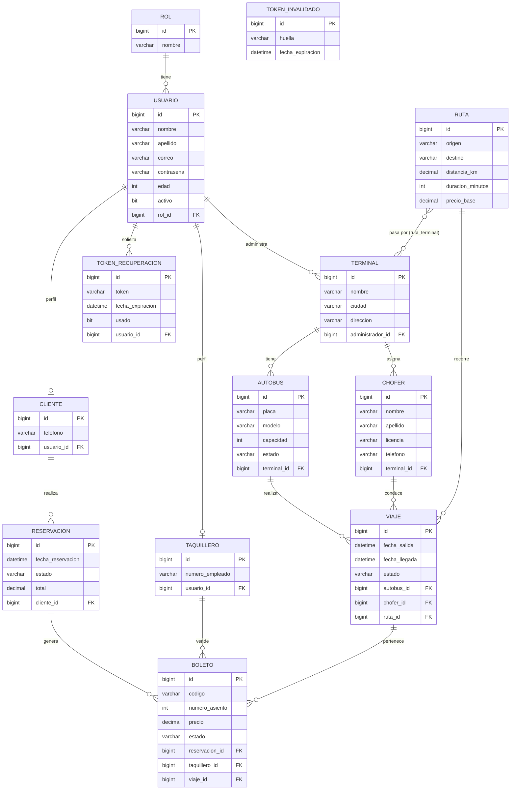

<p align="center">
  <picture>
    <source media="(prefers-color-scheme: dark)" srcset="frontend/public/logo-blanco.svg">
    
  </picture>
</p>

<h1 align="center">PuntoBus</h1>

<p align="center">Sistema de Terminal de Autobuses · Proyecto final full stack, Equipo 05</p>

## Integrantes

- Cortés Cruz Jesús
- Cruz Santiago Roque Antonio

## Descripción

Sistema web para administrar una terminal de autobuses. El administrador da de alta terminales, autobuses, choferes, rutas y viajes. Los taquilleros venden boletos en ventanilla y los clientes se registran, reservan asientos y consultan sus boletos. Al reservar, el cliente recibe aviso por correo, SMS y WhatsApp.

## Enlaces

| Qué | Enlace |
|---|---|
| Proyecto desplegado (HTTPS) | https://equipo05.com |
| URL base de la API | https://equipo05.com/api |
| Tablero de GitHub Projects | https://github.com/users/JesusCortes-designer/projects/1/views/1 |
| Prototipo de Figma | https://www.figma.com/proto/CgJETkFHI0XdeYHSdm8bhr/Sin-t%C3%ADtulo?node-id=135-229&t=IhKYrEGkzcojsuzK-1&scaling=min-zoom&content-scaling=fixed&page-id=0%3A1&starting-point-node-id=135%3A2258 |

## Tecnologías

- **Backend:** Java 17, Spring Boot 3, Spring Security + JWT, Spring Data JPA, Bean Validation
- **Frontend:** React 18 + Vite 5, React Router 6, Axios
- **Base de datos:** MySQL 8 con migraciones de Flyway
- **Comunicación:** Postfix + JavaMailSender (correo), Twilio (SMS), Infobip (WhatsApp)
- **Pruebas de API:** Bruno (carpeta `terminal-autobuses-bruno/`)
- **Despliegue:** VPS con Nginx, Let's Encrypt (Certbot) y systemd

## Diseño: logo y paleta de colores

| | |
|---|---|
| **Nombre del negocio** | PuntoBus |
| **Logo** | Autobús dentro de un círculo, diseñado por el equipo (`frontend/public/logo.svg` y `logo-blanco.svg` para fondos oscuros) |
| **Prototipo** | [Figma](https://www.figma.com/proto/CgJETkFHI0XdeYHSdm8bhr/Sin-t%C3%ADtulo?node-id=135-229&t=IhKYrEGkzcojsuzK-1&scaling=min-zoom&content-scaling=fixed&page-id=0%3A1&starting-point-node-id=135%3A2258) |

La paleta se basa en la **regla 60-30-10**, que reparte el color en tres niveles de peso para que la interfaz se vea equilibrada:

| Peso | Color | Uso en la interfaz | Valores |
|---|---|---|---|
| **60 %** | Blanco y grises claros | Fondos, tarjetas y tablas, para que el contenido respire y se lea con facilidad | `#FFFFFF`, `#F0F1F1` |
| **30 %** | Azules | Menú lateral, barra superior, encabezados de tablas, botones principales y enlaces | `#043B60`, `#095D94`, `#1181CB` |
| **10 %** | Naranja | Acciones y puntos importantes: "Elegir asientos", "Confirmar reservación", precios y opción activa del menú | `#CC7215`, `#FD953F` |

**Por qué estos colores**

- **Azul como color principal.** Es un color frío asociado con calma, confianza y seguridad, adecuado para un sistema donde el usuario compra viajes y deja sus datos. También relaciona la marca con el cielo y la carretera.
- **Blanco para el fondo.** Da descanso visual y hace que los azules y el naranja destaquen donde corresponde.
- **Naranja como color de acento.** Está en el lado opuesto del azul en la rueda de color, es decir, es su **color complementario**. Ese contraste hace que los elementos importantes se noten de inmediato sin saturar la pantalla, porque solo ocupa cerca del 10 %.
- **Variaciones de tono.** Aunque en el código hay más de tres colores, todos son tonos más claros u oscuros de los mismos azules, del naranja y del gris. Se usan para estados como hover, bordes y fondos suaves, y se mantiene la misma armonía. Las variables están en `frontend/src/estilos/base.css` (`--azul-1` a `--azul-7`, `--naranja-1` a `--naranja-6`, `--gris-1` a `--gris-7`).
- **Tipografía.** Poppins, de trazo geométrico y legible en pantallas pequeñas.

## Estructura del repositorio

```
├── backend/                    API REST con Spring Boot
├── frontend/                   aplicación React (Vite)
├── terminal-autobuses-bruno/   colección de pruebas de la API
├── respaldo.sql                respaldo de la base de datos (estructura y datos de prueba)
└── readme.md
```

## Credenciales de prueba

| Rol | Correo | Contraseña |
|---|---|---|
| Administrador (evaluación) | admin@terminal.com | Admin123! |
| Taquillero | taquillero@terminal.com | Taquilla123! |
| Cliente | cliente@terminal.com | Cliente123! |

Se cargan solos la primera vez que arranca el backend.

## Instalación en local

Requisitos: Java 17, Maven, Node.js 18+ y MySQL 8.

### Backend

Crear la base de datos y copiar el archivo de configuración de ejemplo:

```bash
cd backend
mysql -u root -p -e "CREATE DATABASE terminal_autobuses CHARACTER SET utf8mb4;"
cp src/main/resources/application.properties.example src/main/resources/application.properties
```

Completar `application.properties` con usuario y contraseña de MySQL, secreto del JWT, datos del correo y credenciales de Twilio e Infobip. El secreto del JWT se genera con:

```bash
openssl rand -base64 32
```

Iniciar el backend:

```bash
mvn spring-boot:run
```

Flyway crea las tablas y `SemillaDatos` carga los datos de prueba. La API queda en `http://localhost:8080/api`.

### Restaurar el respaldo de la base de datos (opcional)

El archivo `respaldo.sql` de la raíz contiene la estructura y los datos de prueba. Sirve como alternativa a dejar que Flyway y `SemillaDatos` creen todo al arrancar:

```bash
mysql -u root -p -e "CREATE DATABASE IF NOT EXISTS terminal_autobuses CHARACTER SET utf8mb4;"
mysql -u root -p terminal_autobuses < respaldo.sql
```

El respaldo incluye la tabla `flyway_schema_history`, así que al iniciar el backend Flyway reconoce que las migraciones ya están aplicadas.

### Frontend

Con el backend corriendo en el puerto 8080:

```bash
cd frontend
npm install
cp .env.example .env      # en PowerShell: Copy-Item .env.example .env
npm run dev
```

La aplicación queda en `http://localhost:5173`. En desarrollo, Vite redirige las peticiones de `/api` al backend, por lo que no hay problemas de CORS. Si el backend corre en otro puerto, se modifica `VITE_PROXY_DESTINO` en `frontend/.env`.

Versión de producción:

```bash
npm run build      # crea frontend/dist
```

### Pruebas con Bruno

Abrir la carpeta `terminal-autobuses-bruno/` en Bruno, seleccionar el entorno y ejecutar primero `Login` para obtener el token JWT.

## Frontend

### Estructura

```
frontend/src/
├── api/            clienteApi.js (axios + token JWT + manejo de 401)
├── servicios/      una función por endpoint del backend
├── contexto/       sesión (AutenticacionContexto) y avisos (AvisosContexto)
├── hooks/          useFormulario, useListado (paginación en servidor), useConsulta
├── rutas/          RutaProtegida y RutaPublica
├── utilidades/     validaciones, formato, errores, constantes y menús
├── componentes/    comunes (modales, estados), formularios, datos (tablas, paginación), diseño
├── paginas/        publico, cliente, taquilla, admin y comun
└── estilos/        CSS con la paleta del prototipo de Figma
```

### Pantallas por rol

| Rol | Rutas |
|---|---|
| Sin sesión | `/login`, `/registro`, `/recuperar`, `/restablecer?token=...` |
| Cliente | `/cliente`, `/cliente/viajes/:id/asientos`, `/cliente/confirmacion`, `/cliente/reservaciones`, `/cliente/perfil` |
| Taquillero | `/taquilla`, `/taquilla/vender`, `/taquilla/vender/:id`, `/taquilla/boletos`, `/taquilla/perfil` |
| Administrador | `/admin`, `/admin/terminales`, `/admin/rutas`, `/admin/autobuses`, `/admin/choferes`, `/admin/viajes`, `/admin/reservaciones`, `/admin/boletos`, `/admin/usuarios`, `/admin/perfil` |

Si una ruta no corresponde al rol de la sesión, se muestra la pantalla 403; sin sesión se redirige a `/login`.

### Cómo se cumple lo que pide la rúbrica

| Requisito | Dónde está |
|---|---|
| Token JWT en cada petición | `api/clienteApi.js` (interceptor de Axios) |
| Rutas protegidas por rol | `rutas/RutaProtegida.jsx` y `App.jsx` |
| Validaciones bajo cada campo, en tiempo real y al enviar | `hooks/useFormulario.js` y `componentes/formularios/` |
| Errores 422 del servidor bajo el campo correspondiente | `FormularioDinamico.jsx` |
| Paginación y filtros en el servidor | `hooks/useListado.js` (manda `pagina`, `tamano` y filtros) |
| Barra superior con nombre, correo, avatar, perfil y cerrar sesión | `componentes/diseno/BarraSuperior.jsx` |
| Modales de confirmación, sin `alert` ni `confirm` | `componentes/comunes/Modal.jsx` y `ModalConfirmacion.jsx` |
| Estados de carga y errores de red con reintento | `componentes/comunes/EstadosPantalla.jsx` |
| Diseño responsivo | menú lateral tipo cajón y tablas en tarjetas en celular |

## Variables de configuración

Las variables sensibles van en `backend/src/main/resources/application.properties`, que **no se sube al repositorio**. En `application.properties.example` están todas sin valores reales:

- conexión a la base de datos
- `app.jwt.secreto` y `app.jwt.expiracionMs`
- configuración de correo (Postfix)
- credenciales de Twilio e Infobip
- `app.frontend.url` (dirección del frontend; el correo de recuperación enlaza a `/restablecer?token=...`)

El frontend solo usa `frontend/.env` (tampoco se sube): `VITE_PROXY_DESTINO` para desarrollo y, opcionalmente, `VITE_API_URL`.

## Diagrama entidad-relación



La relación muchos a muchos es **Ruta ↔ Terminal** (tabla `ruta_terminal`). Las tablas se crean con las migraciones de `backend/src/main/resources/db/migration/`.

## Endpoints principales

Todos (menos `/api/auth/**`) llevan el header `Authorization: Bearer <token>`. Los listados reciben `pagina` (desde 1), `tamano` y filtros como parámetros, y la paginación se hace en el servidor.

| Ruta | Quién puede |
|---|---|
| `POST /api/auth/login`, `/registro`, `/logout`, `/recuperar`, `/restablecer` | público |
| `GET /api/usuarios/perfil` | cualquier usuario con sesión |
| `PUT /api/usuarios/perfil/contrasena` (cambiar la propia contraseña) | cualquier usuario con sesión |
| `/api/usuarios` (CRUD, filtros `buscar` y `rol`) | Administrador |
| `/api/terminales`, `/api/autobuses`, `/api/choferes` | GET: Administrador y Taquillero. Escritura: Administrador |
| `/api/rutas`, `/api/viajes` | GET: cualquier usuario con sesión. Escritura: Administrador |
| `GET /api/viajes/{id}/asientos-ocupados` | cualquier usuario con sesión |
| `POST /api/reservaciones`, `GET /api/reservaciones/mias` | Cliente |
| `GET /api/reservaciones` | Administrador |
| `PUT /api/reservaciones/{id}/cancelar` | Administrador y Cliente (solo las suyas) |
| `POST /api/boletos` (venta en ventanilla) | Taquillero |
| `GET /api/boletos` | Administrador y Taquillero |
| `GET /api/boletos/mios` | Cliente |
| `PUT /api/boletos/{id}/cancelar` | cualquier usuario con sesión (el cliente solo los suyos) |

### Códigos de error

Los errores regresan en JSON: 400 datos inválidos de negocio, 401 sin token o credenciales incorrectas, 403 sin permiso, 404 no existe, 409 choca con datos existentes, 422 falla de validación (con el detalle por campo), 500 error del servidor.

## Despliegue en el VPS

1. Generar el jar (`mvn clean package -DskipTests`), subirlo al servidor y ejecutarlo como servicio con systemd. El backend escucha en el puerto 8090.
2. Generar el frontend (`npm run build`) y copiar el contenido de `frontend/dist` a `/var/www/terminal`.
3. Configurar Nginx para que sirva esa carpeta, regrese `index.html` para cualquier ruta del frontend y haga proxy de `/api` hacia `localhost:8090`:

   ```nginx
   server {
       listen 80;
       server_name equipo05.com www.equipo05.com;

       root /var/www/terminal;
       index index.html;

       location /api/ {
           proxy_pass http://localhost:8090;
           proxy_set_header Host $host;
           proxy_set_header X-Real-IP $remote_addr;
           proxy_set_header X-Forwarded-For $proxy_add_x_forwarded_for;
           proxy_set_header X-Forwarded-Proto $scheme;
       }

       location / {
           try_files $uri /index.html;
       }
   }
   ```

4. Certificado HTTPS con Let's Encrypt: `sudo certbot --nginx -d equipo05.com -d www.equipo05.com`.
5. Postfix instalado en el mismo VPS, con registros SPF y DKIM en el DNS del dominio.