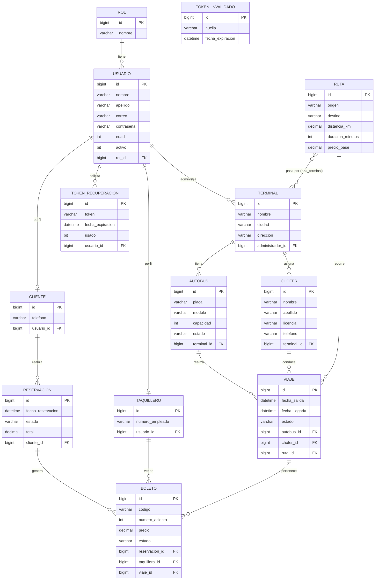

# Sistema de Terminal de Autobuses

Proyecto final full stack, Equipo 05.

## Integrantes

- Cortés Cruz Jesús
- Cruz Santiago Roque Antonio

## Descripción

Sistema web para administrar una terminal de autobuses. El administrador da de alta terminales, autobuses, choferes, rutas y viajes. Los taquilleros venden boletos en ventanilla y los clientes se registran, reservan asientos y consultan sus boletos. Al reservar, el cliente recibe aviso por correo, SMS y WhatsApp.

## Enlaces

| Qué | Enlace |
|---|---|
| Proyecto desplegado (HTTPS) | https://equipo05.com     |
| URL base de la API | https://equipo05.com/api |
| Tablero de GitHub Projects | https://github.com/users/JesusCortes-designer/projects/1/views/1 |
| Prototipo de Figma | PONER-AQUI-EL-LINK |

## Tecnologías

- **Backend:** Java 17, Spring Boot 3, Spring Security + JWT, Spring Data JPA, Bean Validation
- **Frontend:** React + Vite
- **Base de datos:** MySQL 8 con migraciones de Flyway
- **Comunicación:** Postfix + JavaMailSender (correo), Twilio (SMS y WhatsApp)
- **Pruebas de API:** Bruno (carpeta `bruno/`)
- **Despliegue:** VPS con Nginx, Let's Encrypt (Certbot) y systemd

## Estructura del repositorio

```
├── backend/     API REST con Spring Boot
├── frontend/    aplicación React
├── bruno/       colección de pruebas de la API
└── README.md
```

## Credenciales de prueba

| Rol | Correo | Contraseña |
|---|---|---|
| Administrador (evaluación) | admin@terminal.com | Admin123! |
| Taquillero | taquillero@terminal.com | Taquilla123! |
| Cliente | cliente@terminal.com | Cliente123! |

Se cargan solos la primera vez que arranca el backend.

## Instalación en local

Necesitas Java 17, Maven, Node.js 18+ y MySQL 8.

### Backend

```bash
cd backend
mysql -u root -p -e "CREATE DATABASE terminal_autobuses CHARACTER SET utf8mb4;"
cp src/main/resources/application.properties.example src/main/resources/application.properties
```

Edita `application.properties` con tus datos (usuario y contraseña de MySQL, secreto del JWT, correo y Twilio). Para generar el secreto del JWT:

```bash
openssl rand -base64 32
```

Arranca:

```bash
mvn spring-boot:run
```

Flyway crea las tablas y `SemillaDatos` carga los datos de prueba. La API queda en `http://localhost:8080/api`.

### Frontend

```bash
cd frontend
npm install
npm run dev
```

### Pruebas con Bruno

Abre la carpeta `bruno/` desde Bruno, elige el entorno y corre primero `Login` para obtener el token JWT.

## Variables de configuración

Las variables sensibles van en `backend/src/main/resources/application.properties`, que **no se sube al repositorio**. En `application.properties.example` están todas sin valores reales:

- conexión a la base de datos
- `app.jwt.secreto` y `app.jwt.expiracionMs`
- configuración de correo (Postfix)
- credenciales de Twilio

## Diagrama entidad-relación



La relación muchos a muchos es **Ruta ↔ Terminal** (tabla `ruta_terminal`). Las tablas se crean con las migraciones de `backend/src/main/resources/db/migration/`.

## Endpoints principales

Todos (menos `/api/auth/**`) llevan el header `Authorization: Bearer <token>`. Los listados reciben `pagina` (desde 1), `tamano` y filtros como parámetros, y la paginación se hace en el servidor.

| Ruta | Quién puede |
|---|---|
| `POST /api/auth/login`, `/registro`, `/logout`, `/recuperar`, `/restablecer` | público |
| `GET /api/usuarios/perfil` | cualquier usuario con sesión |
| `/api/usuarios` (CRUD, filtros `buscar` y `rol`) | Administrador |
| `/api/terminales`, `/api/autobuses`, `/api/choferes` | GET: Administrador y Taquillero. Escritura: Administrador |
| `/api/rutas`, `/api/viajes` | GET: cualquier usuario con sesión. Escritura: Administrador |
| `GET /api/viajes/{id}/asientos-ocupados` | cualquier usuario con sesión |
| `POST /api/reservaciones`, `GET /api/reservaciones/mias` | Cliente |
| `GET /api/reservaciones` | Administrador |
| `PUT /api/reservaciones/{id}/cancelar` | Administrador y Cliente (solo las suyas) |
| `POST /api/boletos` (venta en ventanilla) | Taquillero |
| `GET /api/boletos` | Administrador y Taquillero |
| `GET /api/boletos/mios` | Cliente |
| `PUT /api/boletos/{id}/cancelar` | cualquier usuario con sesión (el cliente solo los suyos) |

### Códigos de error

Los errores regresan en JSON: 400 datos inválidos de negocio, 401 sin token o credenciales incorrectas, 403 sin permiso, 404 no existe, 409 choca con datos existentes, 422 falla de validación (con el detalle por campo), 500 error del servidor.

## Despliegue en el VPS

1. Subir el jar (`mvn clean package -DskipTests`) y correrlo como servicio con systemd.
2. Compilar el frontend (`npm run build`) y servir la carpeta `dist` con Nginx.
3. Nginx hace proxy de `/api` hacia `localhost:8080`.
4. Certificado HTTPS con Let's Encrypt: `sudo certbot --nginx -d tu-dominio`.
5. Postfix instalado en el mismo VPS, con registros SPF y DKIM en el DNS del dominio.

